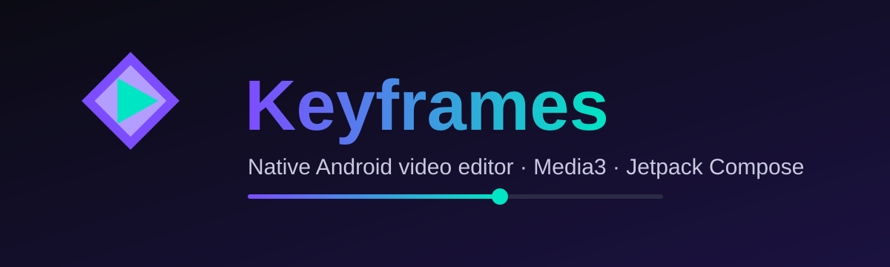
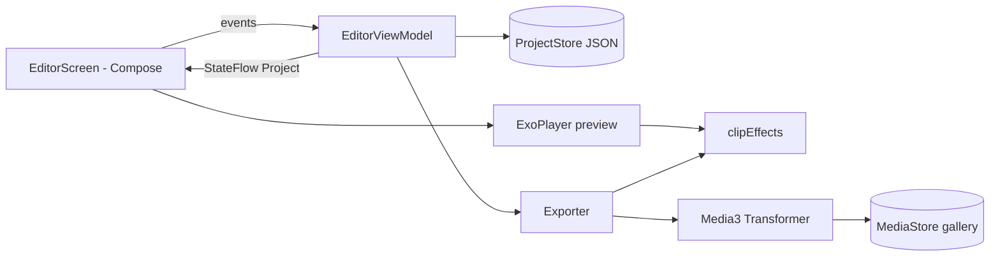
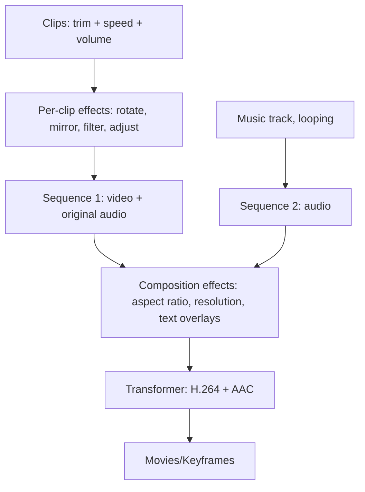

<p align="center"></p>

<p align="center">
  
  
  
  
  
</p>

# Keyframes

A native Android video editor. Every tool runs on the real Media3 engine (ExoPlayer for preview, Transformer for export), with no mock data and no web view.

## Features

| Area | What it does |
|---|---|
| Timeline | Multi-clip timeline with thumbnails, split at playhead, duplicate, delete, reorder |
| Trim | Start/end range per clip |
| Photos | Import images as clips with an adjustable duration (up to 20 s) |
| Freeze frame | Insert a 3-second still of the current frame at the playhead |
| Voiceover | Record from the microphone while the video plays; saved as its own audio track |
| Speed | 0.25x to 4x with pitch-preserved audio |
| Volume | Per-clip volume plus a separate music track with its own volume |
| Filters | Mono, Sepia, Invert, Warm, Cool, plus Cinema, Vivid, Faded and Noir (real 3D LUT color grades) |
| Adjust | Brightness, contrast, saturation, hue, color temperature |
| Zoom and pan | Crop into any part of the frame, up to 4x |
| Fade | Fade in and fade out to black per clip |
| Stickers | Import PNG/JPG images as timed overlays with size and position |
| Transform | Rotate 90 degrees, mirror, aspect ratios (original, 16:9, 9:16, 1:1, 4:5, 4:3) |
| Text | Timed text overlays with position, time range, size and color |
| Music | Import any audio file; it loops to the length of the video and plays in the preview |
| Snapshot | Save the current frame as PNG to Pictures/Keyframes |
| Export | H.264 or HEVC with AAC at 480p, 720p or 1080p with low/medium/high quality, or audio-only M4A; saved to the gallery and shareable |
| Project | Undo / redo (60 steps), automatic project save and a New project button |
| Languages | English, Arabic (RTL), Spanish, French, German, Turkish, Portuguese, Russian, Hindi, Indonesian, Chinese |
| Layout | Compose layout that adapts to any phone width and height |

## Architecture



## Export pipeline



## Build automatically on GitHub

1. Create a repository and push this whole folder (`git add . && git commit -m init && git push`). Make sure the hidden `.github` folder is included.
2. Open the **Actions** tab. The workflow `Build Keyframes APK` starts by itself on every push.
3. When it finishes, download the APK from the run's **Artifacts** section.
4. To publish a release, push a tag such as `v1.0.0` and the APK is attached to the release.

## Build locally

```bash
gradle assembleDebug   # needs JDK 17, Android SDK 34 and Gradle 8.7
```

The APK is written to `app/build/outputs/apk/debug/`.

## Known limitations

- No transitions between clips, reverse playback, blur, or automatic captions. The Media3 version used here does not provide them, and automatic captions would need an external speech model.
- Text and sticker overlays in the live preview are approximate in size. The exported video is the reference.
- Speed and volume apply to video clips only; photos have no audio.

## Notes

- Debug builds are signed with the debug key. For Play Store release, add your own signing config.
- Screenshots are not committed because they have to come from a real build. Add them to `docs/` after your first run.

## طريقة التشغيل بالعربي

ارفع المجلد كله على GitHub (مع مجلد `.github`)، وافتح تبويب **Actions** وهتلاقي البناء بدأ لوحده. بعد ما يخلص نزّل ملف الـ APK من قسم **Artifacts**.
