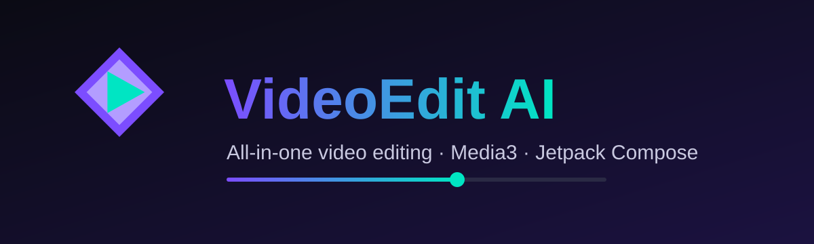
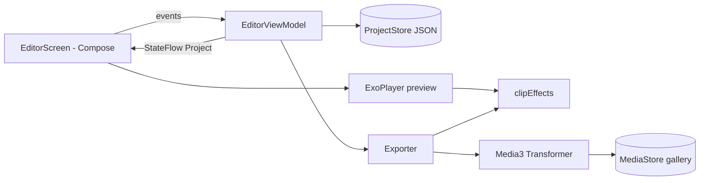
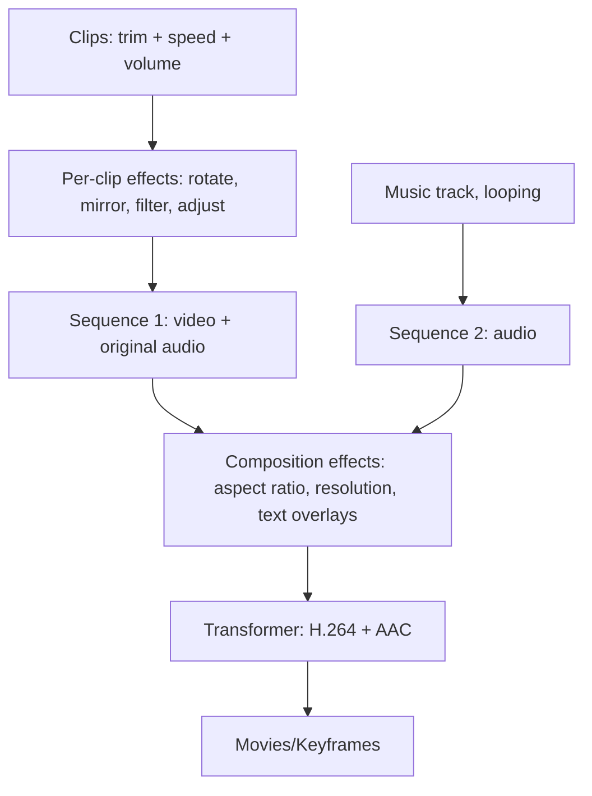

<p align="center"></p>

<p align="center">
  
  
  
  
  
</p>

# VideoEdit AI

A native Android video editor. Every tool runs on the real Media3 engine (ExoPlayer for preview, Transformer for export), with no mock data and no web view.

## Features

| Area | What it does |
|---|---|
| Timeline | CapCut-style timeline: fixed centre playhead, scroll to seek, zoom in/out, filmstrip thumbnails, and separate tracks for clips, text, stickers and audio. Select a layer to drag it, or drag its handles to trim |
| Trim | Start/end range per clip |
| Photos | Import images as clips with an adjustable duration (up to 20 s) |
| Freeze frame | Insert a 3-second still of the current frame at the playhead |
| Voiceover | Record from the microphone from the playhead while the video plays |
| Text to speech | Turn typed text into speech with the phone's own speech engine and place it on the timeline |
| Sound effects | Six effects (ding, whoosh, pop, zap, drum, horn) synthesized on the device |
| Extract audio | Pull the sound out of a clip into its own track |
| Subtitles | Import an .srt file as timed text, or type captions by hand |
| Keyframes | Animate zoom and position over time with keyframes |
| Drafts | Every project is saved as a draft; reopen or delete them from the home screen |
| Speed | 0.25x to 4x with pitch-preserved audio |
| Volume | Per-clip volume plus a separate music track with its own volume |
| Filters | Mono, Sepia, Invert, Warm, Cool, plus Cinema, Vivid, Faded, Noir, Midnight, Vintage, Golden, Sunset, Forest, Rose, Ocean, Cyber, Matte, Bleach, Drama, Pastel, Retro, Sunrise and Moody (real 3D LUT color grades) |
| Adjust | Brightness, contrast, saturation, hue, color temperature, exposure, shadows, highlights, matte and tint |
| Transitions | Push left/right/up/down, zoom, pop and dip-to-black between two clips, with adjustable length |
| Auto enhance | Measures the brightness and contrast of the current frame and sets the adjustments for you (a calculation, not AI) |
| Import LUT | Load any Adobe .cube 3D LUT as a filter |
| Color clips | Solid and gradient clips for intros, outros and title cards, sized to match your video |
| Motion loops | Zoom in/out, pulse, shake, bounce, drift, flash and strobe |
| Waveforms | Real audio waveforms drawn on every audio track |
| Fill to end | Repeat a music track until the end of the project |
| Text styles | Six one-tap style presets plus horizontal position and rotation for text and stickers |
| Export presets | One-tap TikTok, Reels, YouTube, YouTube 4K and WhatsApp settings |
| Apply to all | Copy the selected clip's filter and colour settings to every clip |
| Shapes | Star, heart, arrow, circle, square, diamond and plus, drawn on the device in any colour and used as stickers |
| Zoom and pan | Crop into any part of the frame, up to 4x |
| Fade | Fade in and fade out to black per clip |
| Motion | Slide, zoom or pop in and out of each clip, plus looping Zoom in / Zoom out, Pulse and Shake |
| Pitch | Change voice pitch from 0.5x to 2x, independent of speed, with quick chipmunk / deep presets |
| Transform | Tilt by any angle, flip vertically, mirror horizontally |
| Canvas | Aspect-ratio presets for TikTok, YouTube and Instagram, with Fit (bars) or Fill (crop) |
| Layer actions | Split, duplicate and delete work on whichever layer is selected: clip, text, sticker or audio track |
| Text and sticker animation | Fade, pop, slide up and typewriter (text only) in and out |
| Emoji | Add emoji as timed overlays in one tap |
| Stickers | Import PNG/JPG images as timed overlays with size, position and opacity |
| Transform | Rotate 90 degrees, mirror, aspect ratios (original, 16:9, 9:16, 1:1, 4:5, 4:3) |
| Text | Timed text overlays with position, time range, size, color, bold, background box and four font families |
| Audio tracks | Add as many audio tracks as you like (music, voice, effects) and place each one at any time; all of them play together in the preview and are mixed on export |
| Snapshot | Save the current frame as PNG to Pictures/Keyframes |
| Export | H.264 or HEVC with AAC from 480p up to 4K (4K depends on the device encoder) with low/medium/high quality, or audio-only M4A; saved to the gallery. The frame rate follows the source |
| Project | Undo / redo (60 steps), automatic project save and a New project button |
| Editor layout | Tools grouped in five tabs (Edit, Audio, Text, Effects, Canvas) with a tool panel above them |
| Home screen | Start a new project, continue the last one, or jump straight into any tool |
| Preview | Tap to play or pause, timecode overlay, fullscreen mode, music and voiceover tracks shown under the timeline |
| Share | Send the export directly to TikTok, YouTube, Instagram or WhatsApp when installed, or use the system share sheet |
| Languages | English, Arabic (RTL), Spanish, French, German, Turkish, Portuguese, Russian, Hindi, Indonesian, Chinese |
| Layout | Compose layout that adapts to any phone width and height |

## Architecture



## Export pipeline



## Build automatically on GitHub

1. Create a repository and push this whole folder (`git add . && git commit -m init && git push`). Make sure the hidden `.github` folder is included.
2. Open the **Actions** tab. The workflow `Build VideoEdit AI APK` starts by itself on every push.
3. When it finishes, download the APK from the run's **Artifacts** section.
4. To publish a release, push a tag such as `v1.0.0` and the APK is attached to the release.

## Build locally

```bash
gradle assembleDebug   # needs JDK 17, Android SDK 34 and Gradle 8.7
```

The APK is written to `app/build/outputs/apk/debug/`.

## Known limitations

- Not included: AI auto captions, AI background removal, cloud sync, overlapping transitions (crossfade, wipe) between clips, picture-in-picture video overlays, chroma key, masks, reverse playback, speed curves, reverse playback and blur. Captions and background removal would need an on-device model or an external service, and cloud sync would need a backend. Despite the name, the app has no AI features yet. The Media3 version used here does not provide them, and automatic captions would need an external speech model.
- Text and sticker overlays in the live preview are approximate in size. The exported video is the reference.
- Speed, volume and pitch apply to video clips only; photos have no audio.
- Text to speech needs a speech engine installed on the phone. Sound placed before the first clip or after the end of the project is trimmed on export.

- Motion and fade timing in the live preview can differ slightly from the exported video. The exported file is the reference.

- If the preview ever shows a black screen, tap the magic-wand button on the preview to turn preview effects off. The export is not affected. After a crash, the home screen shows a report you can share.

## Notes

- Debug builds are signed with the debug key. For Play Store release, add your own signing config.
- Screenshots are not committed because they have to come from a real build. Add them to `docs/` after your first run.

## طريقة التشغيل بالعربي

ارفع المجلد كله على GitHub (مع مجلد `.github`)، وافتح تبويب **Actions** وهتلاقي البناء بدأ لوحده. بعد ما يخلص نزّل ملف الـ APK من قسم **Artifacts**.
